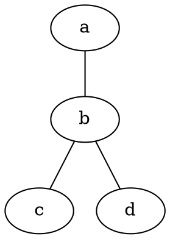
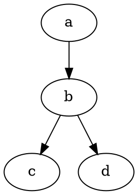

# DOT (graph description language)

Dot graph

::: {#o2 .subject cue=lead name="DOT"}

**DOT** is a [graph](wikipedia://en/325806) description language, developed as a part of the [Graphviz](https://en.wikipedia.org/wiki/Graphviz) project. DOT graphs are typically stored as [files](https://en.wikipedia.org/wiki/Computer_file) with the `.gv` or `.dot` [filename extension](https://en.wikipedia.org/wiki/Filename_extension) — `.gv` is preferred, to avoid confusion with the `[[List of Microsoft Office filename extensions|.dot]]` extension used by versions of [Microsoft Word](https://en.wikipedia.org/wiki/Microsoft_Word) before 2007.[^o3] `dot` is also the name of the main program to process DOT files in the Graphviz package.

:::

Various programs can process DOT files. Some, such as *dot*, *neato*, *twopi*, *circo*, *fdp*, and *sfdp*, can read a DOT file and render it in graphical form. Others, such as *gvpr*, *gc*, *acyclic*, *ccomps*, *sccmap*, and *tred*, read DOT files and perform calculations on the represented graph. Finally, others, such as *lefty*, *dotty*, and *grappa*, provide an interactive interface. The GVedit tool combines a text editor and a non-interactive viewer. Most programs are part of the Graphviz package or use it internally.

DOT is historically an acronym for "DAG of tomorrow", as the successor to a DAG format and a *dag* program which handled only [directed acyclic graphs](wikipedia://en/204002).[^o4]

## Syntax {#Syntax}

### Graph types {#Graph_types}

#### Undirected graphs {#Undirected_graphs}

*Image: DotLanguageUndirected.svg.* An undirected graph

At its simplest, DOT can be used to describe an [undirected graph](wikipedia://en/325806#Undirected_graph). An undirected graph shows simple relations between objects, such as reciprocal friendship between people. The `graph` keyword is used to begin a new graph, and nodes are described within curly braces. A double-hyphen (`--`) is used to show relations between the nodes.

#### Directed graphs {#Directed_graphs}

*Image: DotLanguageDirected.svg.* A directed graph

Similar to undirected graphs, DOT can describe [directed graphs](wikipedia://en/325806#Directed_graph), such as [flowcharts](https://en.wikipedia.org/wiki/Flowchart) and dependency [trees](wikipedia://en/48560). The syntax is the same as for undirected graphs, except the `digraph` keyword is used to begin the graph, and an arrow (->) is used to show relationships between nodes.

### Attributes {#Attributes}

*Image: DotLanguageAttributes.svg.* A graph with attributes

Various attributes can be applied to graphs, nodes and edges in DOT files.[^o10] These attributes can control aspects such as color, shape, and line styles. For nodes and edges, one or more [attribute–value pairs](https://en.wikipedia.org/wiki/Attribute–value_pair) are placed in square brackets `[]` after a statement and before the semicolon (which is optional). Graph attributes are specified as direct attribute–value pairs under the graph element, where multiple attributes are separated by a comma or using multiple sets of square brackets, while node attributes are placed after a statement containing only the name of the node, but not the relations between the dots.

```dot
graph graphname {
    // This attribute applies to the graph itself
    size="1,1";
    // The label attribute can be used to change the label of a node
    a [label="Foo"];
    // Here, the node shape is changed.
    b [shape=box];
    // These edges both have different line properties
    a -- b -- c [color=blue];
    b -- d [style=dotted];
    // [style=invis] hides a node.
}
```

HTML-like labels are supported, although initially Graphviz did not handle them.[^o11]

### Comments {#Comments}

DOT supports [C](https://en.wikipedia.org/wiki/C_%28programming_language%29) and [C++](https://en.wikipedia.org/wiki/C++) style single line and multiple line [comments](https://en.wikipedia.org/wiki/Comment_%28computer_programming%29). In addition, it ignores lines with a number sign symbol `#` as their first character, like many interpreted languages.

## Layout programs {#Layout_programs}

*Image: Huffman (To be or not to be).svg.* Binary tree generated in Graphviz from a DOT description by an online [Huffman Tree generator](http://huffman.ooz.ie/)

The DOT language defines a graph, but does not provide facilities for rendering the graph. There are several programs that can be used to render, view, and manipulate graphs in the DOT language:

### General {#General}

- [Graphviz](https://en.wikipedia.org/wiki/Graphviz) – a collection of CLI utilities and libraries to manipulate and render graphs into different formats like [SVG](https://en.wikipedia.org/wiki/Scalable_Vector_Graphics), [PDF](https://en.wikipedia.org/wiki/PDF), [PNG](https://en.wikipedia.org/wiki/Portable_Network_Graphics) etc.
  - `dot` – CLI tool for conversion between .dot and other formats

### JavaScript {#JavaScript}

- Canviz – a [JavaScript](https://en.wikipedia.org/wiki/JavaScript) library for rendering DOT files[^o16]
- d3-graphviz – a [JavaScript](https://en.wikipedia.org/wiki/JavaScript) library based on Viz.js and [D3.js](https://en.wikipedia.org/wiki/D3.js) that renders DOT graphs and supports animated transitions between graphs and interactive graph manipulation[^o17]
- Vis.js – a [JavaScript](https://en.wikipedia.org/wiki/JavaScript) library that accept DOT as input for network graphs.[^o18]
- Viz.js – a JavaScript port of Graphviz that provides a simple wrapper for using it in the browser.[^o19]
- hpcc-js/wasm Graphviz – a fast [WASM](https://en.wikipedia.org/wiki/WebAssembly) library for Graphviz similar to Viz.js[^o20]

### Java {#Java}

- [Gephi](https://en.wikipedia.org/wiki/Gephi) – an interactive visualization and exploration platform for all kinds of networks and complex systems, dynamic and hierarchical graphs
- Grappa – a partial port of Graphviz to [Java](https://en.wikipedia.org/wiki/Java_%28programming_language%29)
- graphviz-java – an open source partial port of Graphviz to [Java](https://en.wikipedia.org/wiki/Java_%28programming_language%29) available from github.com
- ZGRViewer – a DOT viewer[^o22]

### Other {#Other}

- Beluging – a [Python](https://en.wikipedia.org/wiki/Python_%28programming_language%29)- & [Google Cloud Platform](https://en.wikipedia.org/wiki/Google_Cloud_Platform)-based viewer of DOT and Beluga extensions
- Delineate – a [Rust](https://en.wikipedia.org/wiki/Rust_%28programming_language%29) application for [Linux](https://en.wikipedia.org/wiki/Linux) that can edit fully-featured DOT graph with interactive preview, and export as PNG, SVG, or JPEG
- dot2tex – a program to convert files from DOT to [PGF/TikZ](https://en.wikipedia.org/wiki/PGF/TikZ) or [PSTricks](https://en.wikipedia.org/wiki/PSTricks), both of which are rendered in [LaTeX](https://en.wikipedia.org/wiki/LaTeX)[^o24]
- [OmniGraffle](https://en.wikipedia.org/wiki/OmniGraffle) – a [digital illustration](https://en.wikipedia.org/wiki/Digital_illustration) application for [macOS](https://en.wikipedia.org/wiki/MacOS) that can import a subset of DOT, producing an editable document (but the result cannot be exported back to DOT)
- [Tulip](https://en.wikipedia.org/wiki/Tulip_%28software%29) – a [software framework](https://en.wikipedia.org/wiki/Software_framework) in [C++](https://en.wikipedia.org/wiki/C++) that can import DOT files for analysis[^o25]
- VizierFX – an [Apache Flex](https://en.wikipedia.org/wiki/Apache_Flex) graph rendering library in [ActionScript](https://en.wikipedia.org/wiki/ActionScript)[^o26]

## Notes {#Notes}

## See also {#See_also}

### External links {#External_links}

- [DOT tutorial and specification](https://www.graphviz.org/documentation/)
  - [Drawing graphs with dot](https://www.graphviz.org/pdf/dotguide.pdf)
  - [Node, Edge and Graph Attributes](https://www.graphviz.org/doc/info/attrs.html)
  - [Node Shapes](https://www.graphviz.org/doc/info/shapes.html)
  - [Gallery of examples](https://www.graphviz.org/gallery/)
- [Graphviz Online](https://dreampuf.github.io/GraphvizOnline/): instant conversion and visualization of DOT descriptions
- [Boost Graph Library](https://www.boost.org/libs/graph/doc/index.html)
- [lisp2dot](http://www0.cs.ucl.ac.uk/staff/W.Langdon/lisp2dot.html) or [tree2dot](https://github.com/andrewlin16/tree2dot): convert [Lisp programming language](https://en.wikipedia.org/wiki/Lisp_%28programming_language%29)-like program trees to DOT language (designed for use with [genetic programming](https://en.wikipedia.org/wiki/Genetic_programming))

[^o3]: "File extension .dot or .gv?". *marc.info*. <http://marc.info/?l=graphviz-devel&m=129418103126092>
[^o4]: (2022-11-14). "'dot' name (etymology)". *Graphviz*. <https://forum.graphviz.org/t/dot-name-etymology/1367>
[^o10]: "Node, Edge and Graph Attributes". *graphviz.org*. <http://www.graphviz.org/doc/info/attrs.html>
[^o11]: "Node Shapes: HTML-Like Labels". *graphviz.org*. <http://www.graphviz.org/doc/info/shapes.html#html>
[^o16]: "canviz: graphviz on a canvas". <http://www.ryandesign.com/canviz/>
[^o17]: "GitHub - magjac/d3-graphviz: Graphviz DOT rendering and animated transitions using D3". *github.com*. <https://github.com/magjac/d3-graphviz>
[^o18]: "Import data in DOT language". *vis.js*. <http://visjs.org/docs/network/#importDot>
[^o19]: "Github - Viz.js - Graphviz in your browser". <https://github.com/mdaines/viz-js>
[^o20]: "hpcc-js/wasm". *GitHub*. <https://github.com/hpcc-systems/hpcc-js-wasm#graphviz-graphvizlibwasm>
[^o22]: "ZGRViewer". *zvtm.sourceforge.net*. <https://zvtm.sourceforge.net/zgrviewer.html>
[^o24]: (2019-11-01). "dot2tex – A Graphviz to LaTeX converter". *dot2tex.readthedocs.io*. <https://dot2tex.readthedocs.io/>
[^o25]: "Data Visualization Software – Tulip". *tulip.labri.fr*. <http://tulip.labri.fr/>
[^o26]: "GitHub - gvhung/vizierfx: Automatically exported from code.google.com/p/vizierfx". *github.com*. <https://github.com/gvhung/vizierfx>
